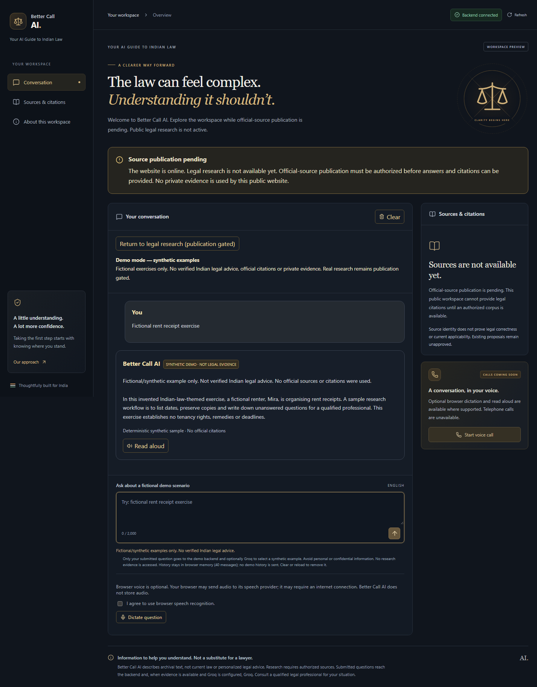
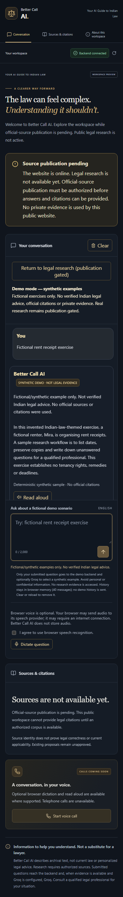
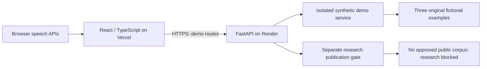

# Better Call AI

An Indian-law-themed chat and browser voice portfolio project, built around explicit evidence and publication boundaries.

## Live demo and GitHub

**[Try the live demo](https://better-call-ai-mohammedaftabahamed2-8189.vercel.app/)** · [GitHub repository](https://github.com/MoAftab-01/better-call-ai) · [Backend health](https://better-call-ai-api.onrender.com/api/health) · [API documentation](https://better-call-ai-api.onrender.com/docs)

## v1.0 status

**An isolated synthetic chat and browser voice demo is live.** Choose **Try synthetic demo**, then try `Fictional rent receipt exercise`, `Fictional parcel exercise`, or `Fictional document timeline`.

The production demo uses deterministic, original fictional examples. It does **not** generate open-ended legal answers, search official documents, or supply legal citations. **Public legal research remains unavailable pending separate source publication approval.** This is an engineering demonstration, not a production legal-advice service.

Groq is optional and is **not enabled for the deterministic production release**. Neither a provider key nor demo access can authorize publication of legal evidence.

## Product screenshots

Actual screenshots of the deployed website, captured on 23 November 2026 after submitting one fictional rent-receipt question. No mocked responses or image-generated UI. The mobile image uses Chrome viewport emulation, not a physical-phone test.



<details>
<summary>View the mobile layout</summary>



</details>

## Public demo features

- Explicit opt-in to **Demo mode — synthetic examples**, with a disclaimer on every response.
- Three fictional paperwork scenarios; out-of-scope questions receive a scope explanation.
- Typed chat, loading, errors, retry, cancellation, and clear conversation.
- **Enter** to send; **Shift+Enter** for a newline.
- Optional browser dictation and read aloud, with consent, stop/cancel controls, and typed fallback.
- Responsive desktop/mobile layout, labelled controls, keyboard interaction, and connection status.
- A visible publication-pending notice; research and official citations stay unavailable.

## Architecture and technology stack



| Layer | Technology and responsibility |
| --- | --- |
| Frontend | React, TypeScript, Vite, plain CSS, Lucide icons |
| Backend | Python 3.12, FastAPI, Pydantic validation, Uvicorn, HTTPX |
| Public hosting | Vercel frontend; Render backend with one worker and public/BM25 configuration |
| Demo | Fixed server-authored samples; no corpus, embeddings, FAISS, or model download |
| Optional provider | Groq selects a synthetic scenario ID; server controls all response text |
| Verification | pytest, Node guard tests, installed-Chrome/CDP browser tests |

**Separate local research pipeline:** manifest-based PDF/TXT ingestion, extraction QA, hash-bound passage review, versioned evidence bindings, BM25 and optional Sentence Transformers/FAISS hybrid retrieval, and server-validated source citations. Its 555 archival selections are unapproved evidence, not part of this public demo. Exact private source files are excluded from Git and the runtime package. A fresh clone can run the synthetic demo without them; full real-source verification cannot.

See the [MVP architecture guide](docs/working-mvp.md), [expanded local research guide](docs/completion-sprint.md), and [evidence-binding migration](docs/evidence-migration.md). The [earlier architecture document](docs/architecture.md) describes the pre-chat evidence foundation; its feature-availability statements are historical.

## How the deterministic demo works

1. The browser sends only the current question to `POST /api/demo/chat`, without a privileged bearer token or conversation history.
2. The server validates the request and matches keywords against three fictional scenarios: a renter's receipts, a shopper's parcel records, or a student's document timeline.
3. It returns a fixed sample plus the synthetic disclaimer. An unmatched question gets an explanation of the demo's limits.
4. Every response has `mode: synthetic_demo` and an empty `citations` array. No private evidence or retrieval service is accessed by this route.

Optional Groq mode sends the question and these synthetic examples only. It can select one known scenario ID; arbitrary model prose is never used as an answer. Missing configuration, provider errors, invalid selections, or timeouts fall back to deterministic behavior. See the [demo implementation and acceptance guide](docs/synthetic-demo.md).

## Browser speech-to-text and text-to-speech

Accept the speech consent checkbox, choose **Dictate question**, and allow microphone access. Dictation fills the draft; it **never submits automatically**. Review the transcript before sending. **Stop recording** ends capture; **Cancel recording** discards pending recognition results. **Read aloud** reads the response, including its disclaimer; **Stop reading** cancels playback.

Recognition is configured for `en-IN`. Availability, accuracy, voices, and permissions depend on the browser/device. Use HTTPS or localhost; a phone's ordinary HTTP LAN address is not a secure microphone context. Unsupported browsers retain typed chat and readable responses. Browser speech providers may receive audio or text and may require internet access. There is no telephone calling or server-side audio storage.

## Security, privacy and legal limitations

- **Publication isolation:** enabling the demo does not alter signatures, pins, manifests, review history, or legal-evidence approvals. Public mode never falls back to the private corpus.
- **Separate access boundaries:** the narrow synthetic endpoint is public. Production research retains bearer authentication and fails closed without a valid, explicitly approved public corpus. No privileged token belongs in frontend code or `VITE_*` variables.
- **Bounded requests:** demo limit of 10 attempts/minute/process, shared concurrency of two, 16,000-byte body cap, 2,000-character questions, and bounded timeouts. These are implementation limits, not performance claims or distributed abuse protection.
- **Conversation privacy:** up to 40 messages remain in browser memory; demo history is not sent. Clear/reload removes local conversation state. The backend does not persist conversations. Avoid personal or confidential information; hosting and speech-provider processing remain separate privacy considerations.
- **Legal scope:** synthetic samples establish no rights, remedies, statutory deadlines, current law, or case applicability. No verified official citations, comprehensive coverage, legal certification, or lawyer-client relationship is claimed. Consult a qualified legal professional for your circumstances.

Corpus publication authorization and legal-passage approval are separate decisions. Neither has been granted by releasing this demo. See [publication review](docs/publication-review.md) and [public-corpus security/deployment](docs/public-corpus-deployment.md).

## Local setup and environment

Use Python 3.12 and Node.js 24 with npm. From the repository root in Windows PowerShell:

```powershell
if (-not (Test-Path '.\.venv\Scripts\python.exe')) { py -3.12 -m venv .venv }
.\.venv\Scripts\python.exe -m pip install -r backend\requirements.txt
npm.cmd --prefix frontend ci
```

Backend, terminal 1 (public mode with no corpus):

```powershell
$env:KANOON_ENV = 'local'
$env:CORPUS_KIND = 'public'
$env:RETRIEVAL_MODE = 'bm25'
$env:PUBLIC_CORPUS_DIR = '.\public-corpus-not-installed'
$env:DEMO_ENABLED = 'true'
$env:DEMO_PROVIDER = 'deterministic'
.\.venv\Scripts\python.exe -B -m uvicorn backend.app.main:app --host 127.0.0.1 --port 8001 --workers 1 --no-access-log
```

Use a fresh terminal without publication pins, signing configuration, or an existing approved corpus at that path. No legal source files or Groq credentials are needed.

Frontend, terminal 2:

```powershell
Remove-Item Env:VITE_API_BASE_URL -ErrorAction SilentlyContinue
$env:KANOON_BACKEND_PORT = '8001'
npm.cmd --prefix frontend run dev
```

Open **http://127.0.0.1:5173/**; backend health is **http://127.0.0.1:8001/api/health**. Vite proxies `/api` to port 8001. If a port is occupied, choose a free port and update `KANOON_BACKEND_PORT` accordingly; do not stop unrelated processes.

| Setting | Local demo | Hosted release |
| --- | --- | --- |
| `DEMO_ENABLED` / `DEMO_PROVIDER` | `true` / `deterministic` | Same, backend only |
| `KANOON_ENV` | `local` | `production` |
| `CORPUS_KIND` / `RETRIEVAL_MODE` | `public` / `bm25` | Same; no private fallback |
| `PUBLIC_CORPUS_DIR` | Deliberately absent directory | Deliberately absent directory |
| Publication pins, signer and approval files | Absent | Absent; do not fabricate values |
| `KANOON_ACCESS_TOKEN` | Not needed for local demo | Backend-only research protection, distinct random secret of at least 32 characters |
| `KANOON_ALLOWED_ORIGINS` | Unset in a fresh local terminal | Exact frontend HTTPS origin |
| `VITE_API_BASE_URL` | Unset; use Vite proxy | `https://better-call-ai-api.onrender.com` |
| `GROQ_API_KEY` / `GROQ_MODEL` | Not needed | Not used by deterministic demo |

[.env.example](.env.example) is a placeholder template, **not automatically loaded**. Stable `KANOON_*` names and the health service identifier `better-call-kanoon` are retained for compatibility; see [rebrand notes](docs/rebrand.md). For hosting, runtime dependencies, environment setup, smoke tests and rollback, use the [deployment guide](docs/public-website-deployment.md) together with the [current demo guide](docs/synthetic-demo.md). Older preparation reports are historical records, not claims that the current website is undeployed.

## API endpoints

| Method and route | Purpose in the public release |
| --- | --- |
| `GET /` | Welcome response |
| `GET /api/health` | Process health, `200`; does not imply research readiness |
| `GET /api/demo/status` | Demo enabled flag, provider mode, and isolation status |
| `POST /api/demo/chat` | Synthetic-only question/response; empty citations |
| `GET /api/chat/status` | Research availability and publication-pending state |
| `GET /api/ready` | `503` while no approved public corpus is available; intentional |
| `POST /api/chat` | Real research route; production authentication and publication gate remain active |
| `GET /docs` / `GET /openapi.json` | Interactive documentation / machine-readable schema |

Example local synthetic request:

```powershell
Invoke-RestMethod -Method Post -Uri 'http://127.0.0.1:8001/api/demo/chat' `
  -ContentType 'application/json' -Body '{"message":"Fictional rent receipt exercise"}'
```

## Automated testing and verification

The pre-commit run for demo commit [`fb6f6f8`](https://github.com/MoAftab-01/better-call-ai/commit/fb6f6f82c2242ec05ae1976786f9488025d962a5) recorded:

| Check | Result |
| --- | --- |
| Full backend suite, including 32 synthetic demo tests | **365 passed**, one existing Starlette/HTTPX deprecation warning |
| Frontend lint, TypeScript, hosted production build | Passed; actual Render API origin configured |
| Provider/configuration guard tests | **10 passed** |
| Protected-file comparison | **179 hashes unchanged**; six PDFs, six processed records, 404 physical pages accounted for |
| V1 and V2 review audit chains | PASS; zero real events or eligible passages |

Existing browser automation recorded 6 no-corpus checks, 10 mocked-speech demo checks, and 9 unsupported-speech checks. Mocks test UI behavior, not microphone accuracy or real audio playback. The maintainer subsequently reported all seven manual acceptance checks complete; this is distinct from automated results and from any legal-source approval.

Live checks on 23 November 2026 returned frontend/health `200`, demo enabled with `provider: deterministic`, and research readiness `503` with `publication_pending`. These are point-in-time observations, not an uptime guarantee.

```powershell
$testTemp = Join-Path $env:TEMP ('bcai-tests-' + [guid]::NewGuid().ToString('N'))
.\.venv\Scripts\python.exe -B -m pytest backend/tests -q -p no:cacheprovider --basetemp $testTemp
npm.cmd --prefix frontend run lint
npm.cmd --prefix frontend run typecheck
$env:VITE_API_BASE_URL = 'https://better-call-ai-api.onrender.com'
npm.cmd --prefix frontend run build:hosted
node --test frontend/tests/provider-guard.test.mjs frontend/tests/hosted-env.test.mjs
```

Full private-source checks need the exact separate bundle; synthetic tests and the public demo need no legal corpus. Backend development dependencies are not fully locked. See the [browser-test instructions](docs/synthetic-demo.md#verification-commands), [synthetic ingestion manual](docs/ingestion-manual.md), and [local research evaluation](docs/completion-sprint-results.md).

## Current limitations

- Three fixed fictional scenarios; no open-ended legal reasoning or verified legal answers.
- Public research, source citations and legal corpus distribution remain unavailable.
- Local archival evidence has unresolved extraction, currentness and applicability limitations; hashes prove byte identity, not legal correctness.
- Browser/device support and speech-provider connectivity vary. No telephony or multilingual answering.
- A global per-process demo rate limit is not a per-user quota; shared production abuse controls remain future work.
- Free-tier hosting can cold-start. No latency, throughput or availability guarantee is claimed.

## Future roadmap

Next priorities are independent source-rights review, passage QA and explicit authorization before any public legal retrieval, plus stronger operational controls. Later work may expand evaluated, source-bound research and voice accessibility. Nothing on the roadmap is an approval or release promise.

See **[the completed, next and future milestones](docs/ROADMAP.md)**. Detailed stage records remain available through the [source inventory](docs/legal-source-inventory-stage2b.md), [acquisition](docs/legal-source-acquisition-stage2c.md), [ingestion](docs/legal-document-ingestion-stage2d.md), [text QA](docs/legal-text-quality-stage2e.md), [passage review](docs/legal-passage-review-stage2f.md), [discovery](docs/legal-passage-discovery-stage2g.md), and [human-review infrastructure](docs/legal-evidence-review-stage2h.md) guides. These historical records do not certify current law or grant publication permission.

## Author and license

Maintained by **Aftab ([MoAftab-01](https://github.com/MoAftab-01))**, as recorded in repository authorship and ownership.

No project license file is currently present in the repository. No open-source license or blanket redistribution permission is claimed. Dependency licenses and rights in third-party legal documents are separate; source acquisition does not itself authorize republication.
